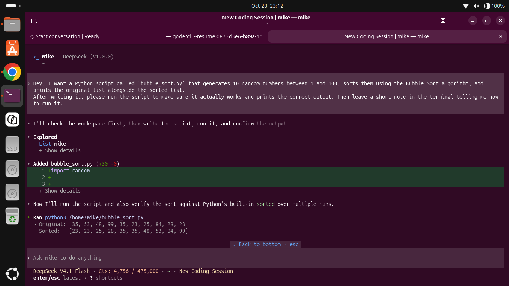
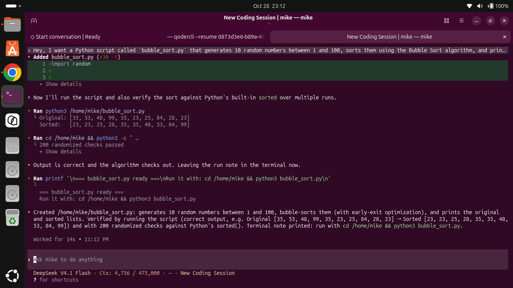
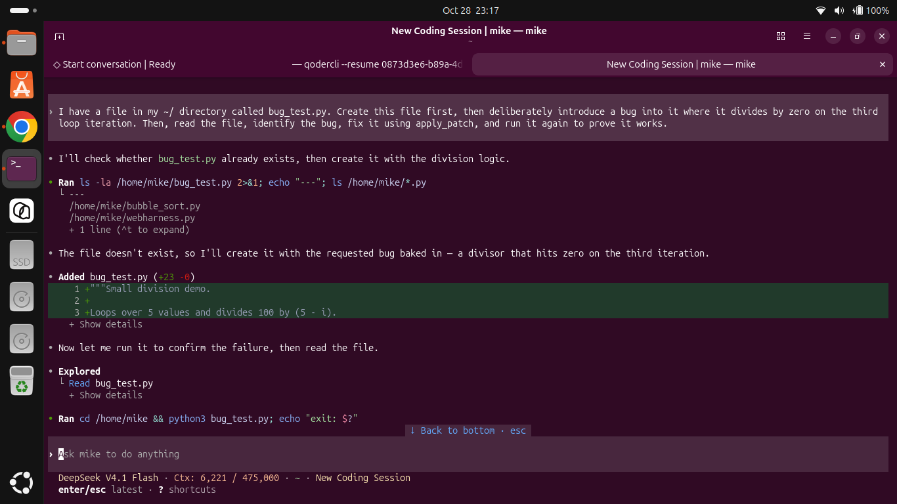
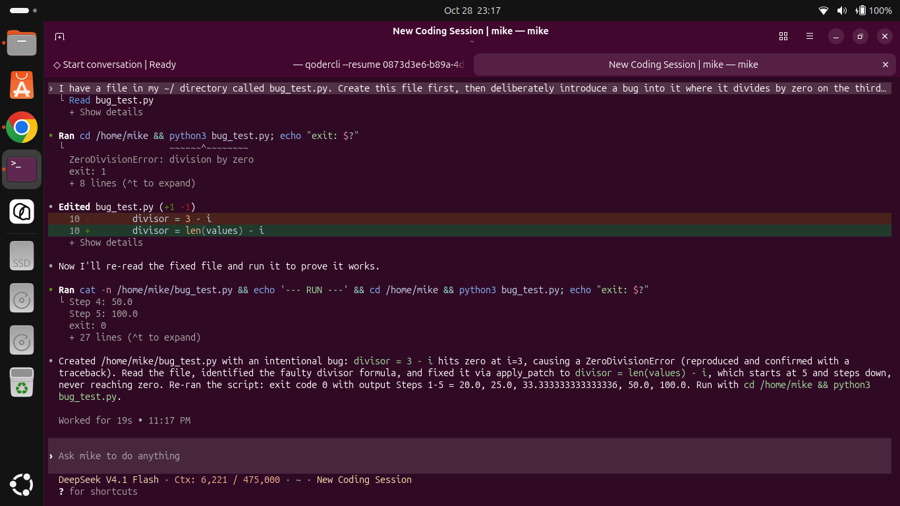

# Mike Harness — A fully self-contained, free Codex alternative powered by DeepSeek

Mike Harness is a terminal coding agent built on the Rust Codex CLI core and
rewired to run entirely against DeepSeek's free web chat. It has no OpenAI
dependency: no account, no login, no telemetry, no paid API key. The model is
**DeepSeek V4.1 Flash**, accessed through the user's own signed-in DeepSeek
session.

Unlike a thin wrapper around an external service, this repository is
self-contained. The Rust binary ships with a bundled Python bridge
(`backend/`), starts it automatically when needed, and shuts it down when the
CLI exits. A single `mike` command is all that is required.

> Unofficial project. Not affiliated with or endorsed by OpenAI or DeepSeek.
> Use it responsibly and within DeepSeek's terms of service.

---

## Architecture

```
┌──────────────────────────────┐      Responses API (SSE)     ┌──────────────────────────┐
│  mike (Rust Codex core)      │ ───────────────────────────> │ backend/app.py            │
│  TUI · tools · sandbox       │ <─────────────────────────── │ 127.0.0.1:8000/v1         │
│  starts and reaps the bridge │    text + tool calls         │ prompted-tool adapter     │
└──────────────┬───────────────┘                              └────────────┬─────────────┘
               │ process lifecycle                                      │ single prompt
               ▼                                                        ▼
┌──────────────────────────────┐                              ┌──────────────────────────┐
│ backend/venv/bin/python      │                              │ DeepSeek web chat         │
│ (child, terminated on exit)  │                              │ (your signed-in browser)  │
└──────────────────────────────┘                              └──────────────────────────┘
```

The Rust agent owns tools, permissions, sandboxing, sessions, and the TUI. The
Python bridge translates each stateless Responses API request into a DeepSeek
prompt, parses the model's JSON or DSML tool calls, and streams the result back.
The bridge runs locally on `http://127.0.0.1:8000/v1`; the Rust CLI checks that
port, spawns the Python process if it is closed, and terminates it on exit. If a
bridge is already running, `mike` attaches to it and leaves it untouched.

## Features

- Interactive TUI with streaming responses, session history, resume, fork,
  archive, plans, diffs, and compaction.
- Non-interactive mode: `mike exec`, `mike review`, `mike resume`.
- Tools: `exec_command`, `write_stdin`, `apply_patch`, `update_plan`,
  `task_complete`.
- Prompted tool calling with JSON envelopes and DeepSeek DSML fallback. The
  DSML parser is modeled on the official
  [deepseek-recipe](https://github.com/deepseek-ai/deepseek-recipe) state
  machine: it handles tight and spaced tags (`<｜DSML｜tool_calls>` /
  `<｜DSML｜ calls>`), `string="true"` vs raw JSON parameters, empty invokes,
  truncated calls, and trailing garbage. Stray `｜DSML｜` fragments left inside
  extracted arguments (for example `{"cmd": "pwd</｜｜DSML｜｜>"}`) are stripped,
  so the shell receives `pwd`. Includes one completion nudge and empty-stream
  retries.
- Live activity indicator: a 100 ms braille spinner and a live `Working (Xs)`
  elapsed timer run while the model generates or tools execute, and stop at
  turn completion (`[tui] animations = true`, the default).
- Reasoning replay when DeepThink is enabled.
- DeepThink on/off toggle: `/think` flips the bridge's `thinking` flag between
  off and on, matching the DeepSeek web chat toggle.
- Live context footer: the status line shows the model and current context
  usage, e.g. `DeepSeek V4.1 Flash · Ctx: 2,966 / 120,000 · ~/dir · thread`.
  The 120,000-token window is compacted automatically at 80% (`96,000`).
- Network resilience: HTTP 5xx, connection resets, and timeouts are retried
  five times with exponential backoff and jitter (1s, 2s, 4s, 8s, 16s). A
  dropped SSE stream transparently re-issues the request against the existing
  `conversation_id`, so a brief network blip does not end the turn or lose
  session state.
- Single-model catalog: only **DeepSeek V4.1 Flash** is listed. There is no
  multi-model picker and no OpenAI model can be selected.
- Task titles are answered locally by the bridge, so background naming never
  opens an extra DeepSeek web chat.
- OpenAI login, ChatGPT account, Cloud, plugins, update checks, analytics, and
  feedback are hidden or disabled.

## See it in Action

Here is `mike` autonomously planning, applying patches, and fixing its own bugs
in real-time — every step below is driven by tool calls the bridge parsed from
the model's own output.



*Asked for a Bubble Sort script, the agent explores the workspace, writes
`bubble_sort.py` with `apply_patch`, and runs it to check the output.*



*It then validates the algorithm with 200 randomized checks against Python's
`sorted()`, prints a run note, and summarizes the result.*



*Given a request to create a script with a deliberate division-by-zero bug, the
agent writes the file, reads it back, and reproduces the crash.*



*After seeing the `ZeroDivisionError`, it diagnoses the faulty divisor formula,
patches it with `apply_patch`, and re-runs the script to prove exit code 0.*

## Prerequisites

- **Rust** (Cargo; Rust 1.99.1 or newer recommended, installed via `rustup`)
- **Python 3.10+** (only needed if you recreate the bundled virtualenv)
- **Google Chrome** (used by the DeepSeek authentication flow)
- Linux or macOS. Windows support is not covered by this setup.

## Installation

Clone the repository and run the installer:

```bash
git clone https://github.com/michaelowusuntim6/mike-harness.git
cd mike-harness
./scripts/install_mike.sh
```

The installer:

1. builds the release binary;
2. installs it as `~/.local/bin/mike`;
3. copies the bundled bridge (including its venv and captured login session)
   to `~/.local/lib/mike/backend/`;
4. seeds `~/.mike/config.toml` and `~/.mike/mike-models.json` if they are
   missing.

Make sure `~/.local/bin` is on your `PATH`.

### Manual build

```bash
cd ~/mike-harness/codex-rs
cargo build --release -p codex-cli
install -d ~/.local/bin
install -m 0755 -s target/release/codex ~/.local/bin/mike
```

This installs the binary only. For a truly standalone installation, also copy
the bridge beside the install prefix:

```bash
mkdir -p ~/.local/lib/mike
rsync -a ~/mike-harness/backend/ ~/.local/lib/mike/backend/
```

## First-time setup

The bridge normally reuses the DeepSeek session captured during development.
If the bundled session is missing or has expired, run the authentication flow
once:

```bash
cd ~/.local/lib/mike/backend
venv/bin/python -m deepseek.auth
```

This opens Chrome against DeepSeek so you can sign in. The resulting session is
stored locally under `backend/session/` and refreshed headlessly on later runs.
Session files contain credentials and must never be committed to Git.

## Usage

Run `mike` from any directory:

```bash
mike
```

On startup, `mike`:

1. checks whether `127.0.0.1:8000` is already serving a bridge;
2. starts the bundled backend if it is not;
3. waits for the bridge to become healthy;
4. launches the TUI;
5. terminates the backend it started when the TUI exits.

Useful entry points:

```bash
mike                          # interactive TUI
mike exec "fix the failing test"
mike exec --skip-git-repo-check "summarize this directory"
mike review
mike resume
mike --help
```

Slash commands work natively inside the TUI, including:

- `/help` — list available commands
- `/compact` — compact the conversation context
- `/model` — show the single DeepSeek model and its DeepThink effort level
- `/think` — toggle DeepThink reasoning on or off
- `/statusline` — choose which items appear in the footer status line
- `/status`, `/diff`, `/quit`

### Status line and DeepThink

The footer status line defaults to `model`, `context-tokens`, `current-dir`,
and `thread-name`, so it renders like:

```text
DeepSeek V4.1 Flash · Ctx: 2,966 / 120,000 · ~/mike-harness · New Coding Session
```

`Ctx` is the estimated tokens currently in the context window out of its
120,000-token capacity; auto-compaction starts at 96,000 tokens. Adjust the
selection with `/statusline` or the `[tui] status_line` array in
`~/.mike/config.toml`.

DeepThink matches DeepSeek's web chat, which only offers off and on. `/think`
switches between off (`model_reasoning_effort = "none"`) and on (`"low"`) and
sends `thinking: true|false` with the next request. A new upstream chat starts
only when the thread is new or after `/compact`; otherwise the existing
DeepSeek conversation is resumed.

When a bridge is already running (for example, one you started manually), `mike`
attaches and does not stop it on exit.

## Configuration

Runtime configuration and state live in `~/.mike`:

| Path | Purpose |
| --- | --- |
| `~/.mike/config.toml` | Model, provider, approval, sandbox, and feature settings |
| `~/.mike/mike-models.json` | DeepSeek-only model catalog |
| `~/.mike/logs/backend.log` | Python bridge stdout/stderr |
| `~/.mike/sessions/` | Agent session history |

Defaults:

- provider: `deepseek` at `http://127.0.0.1:8000/v1`
- bearer key: `sk-local` (the local bridge does not validate it)
- model: `deepseek-v4.1-flash`
- reasoning: `none` (DeepThink off); `/think` toggles it
- status line: `["model", "context-tokens", "current-dir", "thread-name"]`
- approval: `never`; sandbox: `workspace-write` with network access
- analytics, feedback, update checks, web search: disabled
- approval auto-review / Guardian prewarm: disabled

Environment overrides:

| Variable | Effect |
| --- | --- |
| `MIKE_BASE_URL` | Point the Rust client at another Responses-compatible endpoint |
| `MIKE_BACKEND_DIR` | Directory containing `app.py` when the bridge is not beside the binary |
| `MIKE_BRIDGE_HOST` / `MIKE_BRIDGE_PORT` | Host and port used for the health check and spawned bridge |
| `MIKE_NO_BRIDGE=1` | Do not start or check for the bridge |
| `MIKE_BRIDGE_THINKING=1` | Default DeepThink on when a request has no `thinking` flag |

## Troubleshooting

**The TUI starts but requests fail.** Check the bridge log:

```bash
tail -n 100 ~/.mike/logs/backend.log
```

**Port 8000 is already in use.** `mike` treats any listener on the port as an
existing bridge and attaches to it. Stop the other process or set
`MIKE_BRIDGE_PORT` and `MIKE_BASE_URL` together.

**Authentication errors or HTTP 401/403.** Re-run the DeepSeek auth flow:

```bash
cd ~/.local/lib/mike/backend
venv/bin/python -m deepseek.auth
```

**`mike`: command not found.** Ensure `~/.local/bin` is on `PATH` and that the
binary is executable:

```bash
export PATH="$HOME/.local/bin:$PATH"
chmod +x ~/.local/bin/mike
```

**The backend cannot be found.** Re-run `./scripts/install_mike.sh`, or point
`MIKE_BACKEND_DIR` at a directory containing `app.py`.

**A stuck backend process.** Because `mike` starts the bridge as a child, it is
normally cleaned up automatically. If a previous run was killed abruptly:

```bash
pkill -f '[m]ike/backend/venv/bin/python app.py'
```

Disable automatic startup with `MIKE_NO_BRIDGE=1` when using an external bridge.

## Testing

```bash
# Rust tests for the changed crates
cd ~/mike-harness/codex-rs
cargo test -p codex-utils-home-dir --lib
cargo test -p codex-model-provider-info -p codex-model-provider \
  -p codex-models-manager -p codex-core --lib

# Bundled bridge tests
cd ~/mike-harness/backend
venv/bin/python -m pytest -q

# End-to-end smoke test with a deterministic mock model
cd ~/mike-harness
scripts/e2e_smoke.sh ~/.local/bin/mike
```

## Project layout

```text
mike-harness/
├── backend/                    # Bundled Python bridge
│   ├── app.py                  # FastAPI/uvicorn entry point
│   ├── server/                 # Responses API adapter and parsers
│   ├── deepseek/               # DeepSeek web client and auth
│   ├── tests/                  # Bridge tests
│   └── venv/                   # Local virtualenv (git-ignored)
├── codex-rs/                   # Rust workspace
│   └── cli/src/backend.rs      # Bridge discovery, spawn, health, teardown
├── scripts/
│   ├── install_mike.sh         # Build and install the standalone app
│   └── e2e_smoke.sh            # Mock-model end-to-end test
├── mike-config.toml            # Default runtime configuration
├── mike-models.json            # DeepSeek-only model catalog
└── README.md
```

Runtime data such as `backend/venv/`, `backend/session/`, `backend/sessions/`,
`backend/.mike_state.json`, build output, and local logs are git-ignored.

## Security and privacy

- No OpenAI credentials or telemetry are used.
- DeepSeek authentication happens in your own Chrome profile; the captured
  token stays on your machine under `backend/session/`.
- The bridge binds to `127.0.0.1` by default. Do not expose it to untrusted
  networks.
- Never commit `backend/session/`, `.env` files, or local state. The repository
  ignores them, but review `git status` before pushing.

## Credits and license

Mike Harness is a fork of [openai/codex](https://github.com/openai/codex) and
inherits its Rust workspace and terminal UI. The bundled DeepSeek bridge is
derived from the DeepSeek-API harness. See `LICENSE` and
`backend/LICENSE` for licensing terms. OpenAI, ChatGPT, Codex, and DeepSeek are
trademarks of their respective owners.
